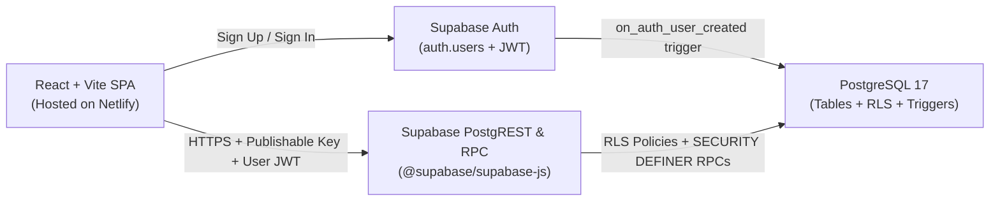

# System Architecture — Library Management System

## 1. Technology Stack

| Layer | Technology |
|---|---|
| **Frontend UI** | React 19 + Vite 6 + TypeScript |
| **Styling & Icons** | Custom CSS (Minimal Black & White Theme) + `lucide-react` |
| **Database** | Supabase PostgreSQL 17 (Free Plan) |
| **Authentication** | Supabase Auth (Email & Password JWT sessions) |
| **Data Access Client** | `@supabase/supabase-js` |
| **Authorization** | PostgreSQL Row Level Security (RLS) + `SECURITY DEFINER` RPCs |
| **Hosting** | Netlify Free Plan (Static SPA Hosting + Redirects) |
| **Source Control** | GitHub (`shaikrohit/library-management-system`) |

---

## 2. Architecture Flow

---

## 3. Security Model

1. **Public Client Configuration Only:** The frontend bundle receives only `VITE_SUPABASE_URL` and `VITE_SUPABASE_PUBLISHABLE_KEY`. No Supabase service-role key or database password is ever placed in client code or GitHub.
2. **Tamper-Proof Role Resolution:** User roles (`ADMIN` vs `MEMBER`) are stored in `public.app_user`, NOT read from mutable client-editable `user_metadata`. All RLS policies and RPCs call `public.is_admin()` or `public.current_member_id()`, which query `public.app_user` using `auth.uid()`.
3. **Forced `MEMBER` Role on Public Signup:** The `on_auth_user_created` database trigger always inserts `role = 'MEMBER'` regardless of any metadata submitted by a client.
4. **Row Level Security Isolation:**
   - Anonymous users cannot query any table (`author`, `book`, `member`, `book_transaction`, `fine`).
   - Authenticated `MEMBER` users can read the book/author catalog, their own `member` profile, their own `book_transaction` rows, and their own `fine` rows.
   - Direct `INSERT`/`UPDATE`/`DELETE` on `book_transaction` and `fine` are disabled for all client roles; mutations execute strictly through `SECURITY DEFINER` stored procedures (`issue_book`, `return_book`, `mark_fine_paid`) that enforce `is_admin()`.
5. **One-Time Initial Administrator Bootstrap:** `/admin-setup` verifies a cryptographically random token against its SHA-256 hash in `public.app_setup_config` (a table with RLS enabled and zero API policies). Once the first administrator is created, `has_admin()` returns `true` and the setup flow is permanently disabled.
