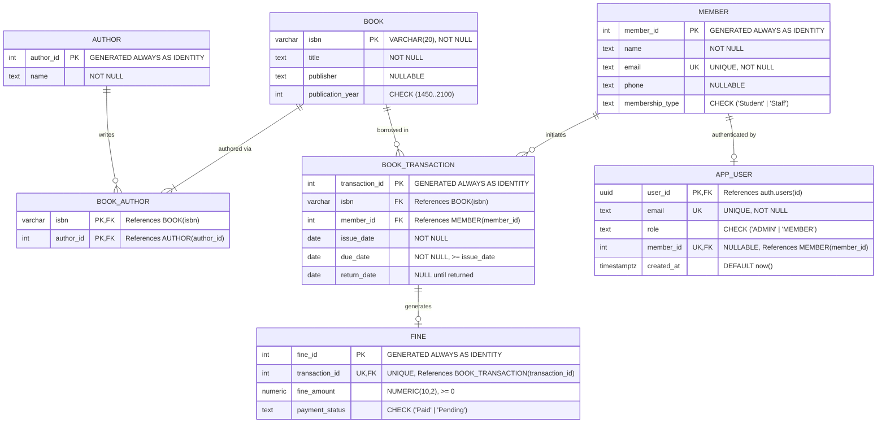

# Entity-Relationship (ER) Modeling — Library Management System

**Student:** Shaik Rohit (`26MLA08010`)  
**Institution:** Madanapalle Institute of Technology & Science (MITS)  
**Department:** Computer Science and Engineering (Cyber Security)  
**Subject:** Database Concepts and Application Laboratory  

---

## 1. Entity-Relationship Diagram

---

## 2. Entities & Cardinalities

| Relationship | Entities | Cardinality | Business Rule |
|---|---|---|---|
| **Writes** | `AUTHOR` — `BOOK` (via `BOOK_AUTHOR`) | Many-to-Many (`M:N`) | A book can have multiple authors; an author can write multiple books. Resolved using composite PK `(isbn, author_id)`. |
| **Borrowed In** | `BOOK` — `BOOK_TRANSACTION` | One-to-Many (`1:N`) | A book can appear in multiple historical transactions, but a PostgreSQL partial unique index restricts it to at most **one active** (`return_date IS NULL`) transaction at a time. |
| **Borrows** | `MEMBER` — `BOOK_TRANSACTION` | One-to-Many (`1:N`) | A registered member can borrow multiple books over time. |
| **Authenticated By** | `MEMBER` — `APP_USER` | One-to-Zero-or-One (`1:0..1`) | Each `MEMBER` login maps to one `APP_USER` row (`role = 'MEMBER'`), whereas `ADMIN` rows have `member_id IS NULL`. |
| **Generates** | `BOOK_TRANSACTION` — `FINE` | One-to-Zero-or-One (`1:0..1`) | An overdue return (`return_date > due_date`) automatically generates at most one fine record (`UNIQUE(transaction_id)`) at ₹5/day. |
